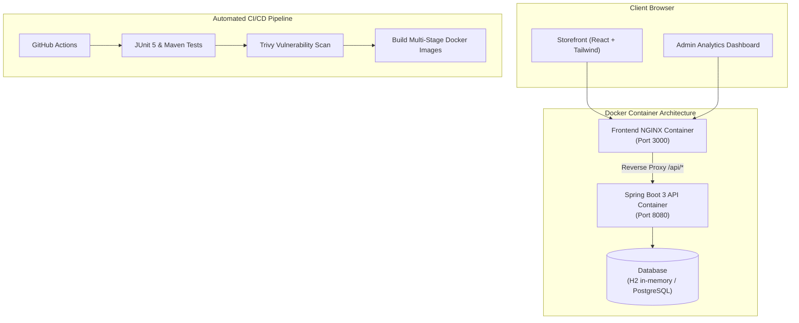

# ⚡ ZENITH — Full-Stack E-Commerce & Merchant Analytics Platform

> A production-grade, cloud-native full-stack application built with **Java 21, Spring Boot 3, React (Vite), Tailwind CSS, Docker, and GitHub Actions CI/CD**.

---

## 🌟 Key Highlights

- **Backend Architecture:** Java 21, Spring Boot 3.3, Spring Data JPA, Hibernate, and embedded H2 (with PostgreSQL production driver).
- **Merchant Analytics Engine:** Aggregates real-time order volume, total revenue, average order value (AOV), and top-selling SKUs directly via database queries.
- **Frontend Design:** Sleek, dark-mode first UI built with React 18, Tailwind CSS, Lucide icons, glassmorphism cards, and live slide-out checkout drawer.
- **DevSecOps & CI/CD:** GitHub Actions pipeline running JUnit 5 tests, Trivy vulnerability audits, and multi-stage Docker builds.
- **Zero Host Tooling Needed:** Builds and runs completely inside Docker containers via `docker-compose`.

---

## 🏗️ Architecture



---

## 🚀 Quick Start (Run Locally in 1 Command)

### Prerequisites
- [Docker Desktop](https://www.docker.com/products/docker-desktop/) (Running)

### Launch the Full Stack
From the project root:
```bash
docker compose up --build
```

- **Storefront & Admin Analytics:** [http://localhost:3000](http://localhost:3000)
- **Spring Boot REST API:** [http://localhost:8080/api/products](http://localhost:8080/api/products)
- **Spring Boot Actuator Health:** [http://localhost:8080/actuator/health](http://localhost:8080/actuator/health)
- **H2 Database Console:** [http://localhost:8080/h2-console](http://localhost:8080/h2-console) (JDBC URL: `jdbc:h2:mem:zenithdb`)

---

## 📡 REST API Documentation

| Method | Endpoint | Description |
| :--- | :--- | :--- |
| `GET` | `/api/products` | Retrieve catalog with optional `category` or `search` query |
| `GET` | `/api/products/{id}` | Retrieve specific product details |
| `POST` | `/api/products` | Create a new product (Admin) |
| `GET` | `/api/orders` | Retrieve list of all placed orders |
| `POST` | `/api/orders` | Place a new order with stock validation and auto-total calculation |
| `GET` | `/api/analytics` | Get live business metrics: Revenue, Orders, AOV, Top SKUs |
| `GET` | `/actuator/health` | Container health check probe for Cloud Orchestrators (ECS/K8s) |

---

## 🔒 DevSecOps & Security
The included `.github/workflows/ci-cd.yml` pipeline implements **Shift-Left Security**:
- **Code Audit:** Runs automated Maven unit tests before container build.
- **Trivy Vulnerability Scanner:** Scans filesystem and dependencies for critical CVEs.
- **Least Privilege:** Backend runtime container runs under a non-root `spring` user.
