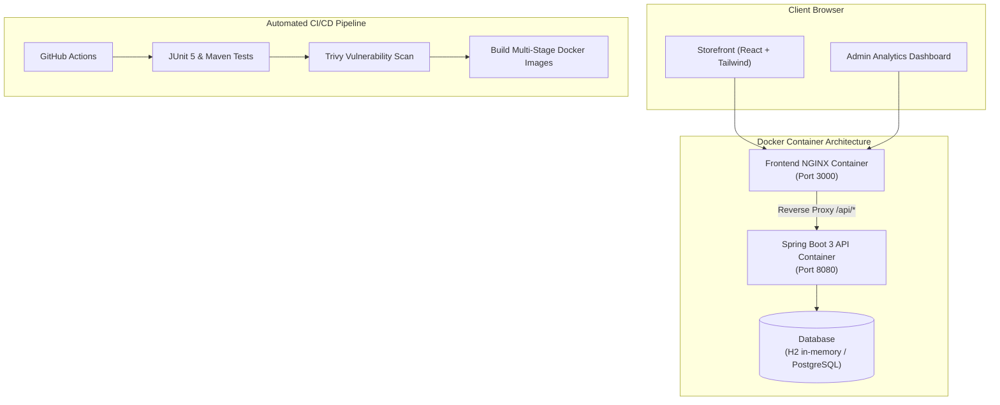

# ⚡ ZENITH — Full-Stack E-Commerce & Merchant Analytics Platform

> A production-grade, cloud-native full-stack application built with **Java 21, Spring Boot 3, React (Vite), Tailwind CSS, Docker, and GitHub Actions CI/CD**.

---

## 🌟 Key Highlights

- **Backend Architecture:** Java 21, Spring Boot 3.3, Spring Data JPA, Hibernate, and embedded H2 (with PostgreSQL production driver).
- **Merchant Analytics Engine:** Aggregates real-time order volume, total revenue, average order value (AOV), and top-selling SKUs directly via database queries.
- **Frontend Design:** Sleek, dark-mode first UI built with React 18, Tailwind CSS, Lucide icons, glassmorphism cards, and live slide-out checkout drawer.
- **DevSecOps & CI/CD:** GitHub Actions pipeline running JUnit 5 tests, Trivy vulnerability audits, and multi-stage Docker builds.
- **Zero Host Tooling Needed:** Builds and runs completely inside Docker containers via `docker-compose`.

---

## 🏗️ Architecture



---

## 🚀 Quick Start (Run Locally in 1 Command)

### Prerequisites
- [Docker Desktop](https://www.docker.com/products/docker-desktop/) (Running)

### Launch the Full Stack
From the project root:
```bash
docker compose up --build
```

- **Storefront & Admin Analytics:** [http://localhost:3000](http://localhost:3000)
- **Spring Boot REST API:** [http://localhost:8085/api/products](http://localhost:8085/api/products) (or [http://localhost:3000/api/products](http://localhost:3000/api/products) via NGINX)
- **Spring Boot Actuator Health:** [http://localhost:8085/actuator/health](http://localhost:8085/actuator/health) (or [http://localhost:3000/actuator/health](http://localhost:3000/actuator/health))
- **H2 Database Console:** [http://localhost:8085/h2-console](http://localhost:8085/h2-console) (JDBC URL: `jdbc:h2:mem:zenithdb`)

---

## 📡 REST API Documentation

| Method | Endpoint | Description |
| :--- | :--- | :--- |
| `GET` | `/api/products` | Retrieve catalog with optional `category` or `search` query |
| `GET` | `/api/products/{id}` | Retrieve specific product details |
| `POST` | `/api/products` | Create a new product (Admin) |
| `GET` | `/api/orders` | Retrieve list of all placed orders |
| `POST` | `/api/orders` | Place a new order with stock validation and auto-total calculation |
| `GET` | `/api/analytics` | Get live business metrics: Revenue, Orders, AOV, Top SKUs |
| `GET` | `/actuator/health` | Container health check probe for Cloud Orchestrators (ECS/K8s) |

---

## 🗄️ Database Architecture

The project supports both fast local prototyping and production-grade persistent database storage:

| Environment | Database Engine | URL / Host | Default Credentials |
| :--- | :--- | :--- | :--- |
| **Local Standalone** | Embedded H2 (In-Memory) | `jdbc:h2:mem:zenithdb` | User: `sa` / Password: `(none)` |
| **Docker & Cloud** | PostgreSQL 16 Alpine | `jdbc:postgresql://postgres:5432/zenithdb` | User: `zenithuser` / Password: `zenithpass` |

- **Automatic Schema Migration:** Managed by Hibernate (`ddl-auto: update`).
- **Data Seeding:** [DataSeeder.java](backend/src/main/java/com/zenith/config/DataSeeder.java) automatically initializes 10 premium tech products, category tags, customer accounts, and system administrator credentials on first run.
- **Data Persistence:** Persistent cloud volume (`zenith_pgdata` / `zenith_prod_pgdata`) preserves all inventory, media, customer accounts, and orders across container restarts.

---

## ☁️ Running on AWS Cloud (EC2 / Ubuntu VM)

### 1. Provision the Cloud Instance
Provision an Ubuntu 22.04 / 24.04 LTS instance (e.g. AWS EC2 `t2.micro` or `t3.small`). Clone this repo and run the automated provisioning script:
```bash
git clone <your-repo-url> zenith-platform
cd zenith-platform
chmod +x scripts/*.sh
./scripts/setup-aws-ec2.sh
```
*This installs Docker, Docker Compose, sets up 3GB Swap space to protect against t2.micro OOM, and configures permissions.*

### 2. Launch Stack with 1 Command
```bash
./scripts/start-cloud.sh
```
This automatically builds and launches:
- 🌐 **Storefront & Admin Analytics:** `http://<YOUR-SERVER-IP>`
- 🛡️ **Admin Portal:** `http://<YOUR-SERVER-IP>/admin`
- 🔌 **REST API:** `http://<YOUR-SERVER-IP>:8085/api/products` (or `http://<YOUR-SERVER-IP>/api/products` via NGINX)
- 🐘 **PostgreSQL Database:** Port `5432` (`zenithdb`)
- ⚙️ **Jenkins CI/CD Server:** `http://<YOUR-SERVER-IP>:8082`

---

## 🚀 Jenkins CI/CD Pipeline

The platform includes a dedicated, containerized Jenkins service with JDK 21, Maven, Node.js 20, and Docker CLI pre-installed ([Dockerfile.jenkins](Dockerfile.jenkins)).

### 1. Start Jenkins
```bash
docker compose -f docker-compose.jenkins.yml up --build -d
```
Access Jenkins at **`http://localhost:8082`** (or `http://<YOUR-SERVER-IP>:8082`).

### 2. Retrieve Admin Unlock Key
```bash
docker exec zenith-jenkins cat /var/jenkins_home/secrets/initialAdminPassword
```

### 3. Pipeline Stages ([Jenkinsfile](Jenkinsfile)):
1. **Sanity Check:** Verifies Git branch, commit SHA, and Docker engine access.
2. **Backend Unit Tests & Packaging:** Compiles Spring Boot 3.3 and runs JUnit 5 test suite with Maven.
3. **Frontend Build & Lint:** Runs `npm install` and `npm run build` using Vite.
4. **Docker Image Build:** Builds multi-stage production Docker images tagged with the build number.
5. **Trivy Vulnerability Scan:** Audits images for CVE vulnerabilities.
6. **Container Registry Push:** Authenticates and pushes images to Docker Hub or AWS ECR.
7. **Continuous Deployment (CD):** Connects to remote cloud instance via SSH and runs [deploy.sh](scripts/deploy.sh) for zero-downtime rolling restart.

---

## 🔒 DevSecOps & Security
The included `.github/workflows/ci-cd.yml` and `Jenkinsfile` pipelines implement **Shift-Left Security**:
- **Code Audit:** Runs automated Maven unit tests before container build.
- **Trivy Vulnerability Scanner:** Scans filesystem and dependencies for critical CVEs.
- **Least Privilege:** Backend runtime container runs under a non-root `spring` user.

